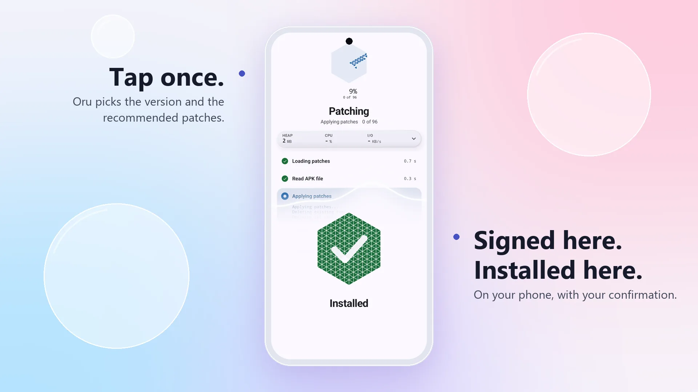
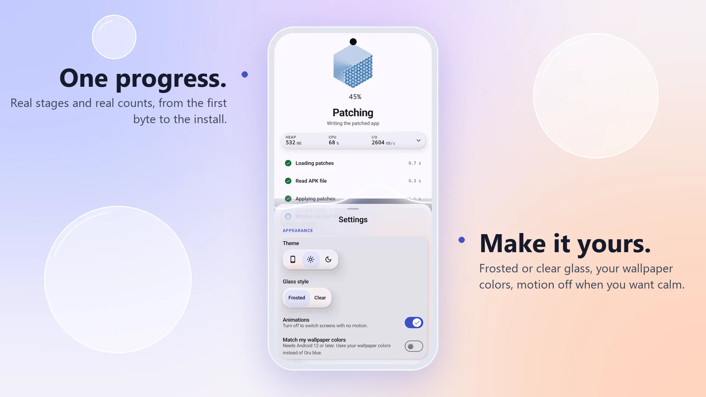

<div align="center">

<picture>
  <source media="(prefers-color-scheme: dark)" srcset="site/assets/mark-dark.svg">
  
</picture>

# oru

Patch Android apps on your own device.

[](LICENSE)
[](https://github.com/The-FunMan/oru/releases/latest)
[](https://github.com/The-FunMan/oru/actions/workflows/ci.yml)

Project page: <https://the-funman.github.io/oru/>

</div>

Oru patches Android apps on your own device. It takes an APK you already have, runs patch bundles on the phone, and installs the patched app.

Oru is an Android app. It is not a ROM hack or a game.

<div align="center">

<picture>
  <source media="(prefers-color-scheme: dark)" srcset="site/assets/shots/split-start-done-dark.webp">
  
</picture>

<picture>
  <source media="(prefers-color-scheme: dark)" srcset="site/assets/shots/split-progress-key-dark.webp">
  
</picture>

</div>

## Why Oru

Oru runs the same patch bundles as other patch managers. What differs is the app around them: it is built to be simple, beautiful and quick to understand.

- **Beautiful.** Fluid motion, soft glass and one hexagon that fills as your app is patched.
- **Current.** Dependencies are checked every day and kept on the newest stable release. What is held back on purpose is listed in [docs/dependencies.md](docs/dependencies.md).
- **Fast.** In one emulator test with the same input and the same 96 patches, Oru patched in about 90 seconds and another well-known patch manager in about 156. That is one small test, so read the [method and limits](docs/benchmarks.md).
- **Simple and Expert.** In Simple, each app shows one sentence and one button. The Simple and Expert switch is on the bottom bar of the Home screen. Expert lets you choose the version, patches, options, installer and patch channel for each app.
- **One patch source per app.** You choose it in Expert mode. Adding a source never changes the apps you already set up.
- **One progress for the whole run.** A run shows the real stages and real counts, not invented progress.
- **Your APK, selected in the app.** Pick an app installed on this device, or use an APK file you already have. Oru uses its own file list when All files access is allowed, and Android's picker when it is not.
- **Everything on the device.** Patching runs on the phone. Oru has no accounts and no analytics, and it does not upload your APK files.

## Install

1. Open the [latest release](https://github.com/The-FunMan/oru/releases/latest) and download `oru-<version>.apk`. Development builds are published as pre-releases.
2. Check the file's SHA-256 against `SHA256SUMS.txt` on the same release, for example with `sha256sum oru-<version>.apk`. On Windows, use `Get-FileHash oru-<version>.apk -Algorithm SHA256`.
3. Optional: verify the build provenance with the GitHub CLI:
   `gh attestation verify oru-<version>.apk --repo The-FunMan/oru`
4. Open the APK and allow installs from the app you used to download it when Android asks.

The release workflows check the signing certificate before they publish. The certificate's SHA-256 is not printed in the release notes.

To receive new releases automatically, add `https://github.com/The-FunMan/oru` to [Obtainium](https://github.com/ImranR98/Obtainium) and let it track GitHub releases. Turn on pre-releases only if you want development builds.

Oru also checks for new releases of itself when it starts. When you choose to update, it downloads the release APK from GitHub, checks it against `SHA256SUMS.txt` and the installed signature, and then asks Android to install it.

## How patching works

1. Choose an app installed on this device, or select an APK file you already have.
2. Choose a version. Oru picks the newest version the patches support and marks it Recommended. In Expert mode you can pick another one, which changes the APKMirror link.
3. If you need the file, choose Find on APKMirror. It opens the APKMirror page for that version in your browser. Oru does not download the APK for you. Back in Oru, choose Use a file and select the file.
4. Choose patches. Simple uses the recommended set. In Expert mode, switched on from the bottom bar of the Home screen, you can choose patches and their options.
5. Oru patches the APK on the device, signs it with a signing key that is created on this device at the first patch, and installs it through the installer you chose (Settings, Advanced, Installing), when Android or that installer allows.

A patched app is signed with a different key than the stock app, so Android does not install it over the stock app. Oru can remove the stock app first. You confirm that, or with Shizuku you can turn on Uninstall the original after installing in Settings, Advanced, Installing. Uninstalling an app deletes its data. Back up anything you need before you patch.

## Patch sources

Oru runs patch bundles. The default source is the patch bundle of the Morphe project, published at [MorpheApp/morphe-patches](https://github.com/MorpheApp/morphe-patches). Oru downloads it from GitHub when it loads sources. The bundle is not part of this repository or of the APK. You manage sources in Settings, Advanced, Sources.

You can add more sources: a GitHub or GitLab repository, a bundle at an https address, or a local `.mpp` file. Each bundle is made and licensed by its authors. Oru does not review or vouch for the patches in a bundle.

## Requirements

- Android 8.0 (API 26) or newer.
- Shizuku is optional. When Shizuku is running and Oru is allowed to use it, Oru can install without showing the system prompt.
- Root is optional. When the device is rooted and you grant root access, Oru can install through root.
- Free storage for the original APK copy, the patched output and the app data. Check the size of the app you want to patch first.
- Oru declares the permissions it needs: internet access, installing and removing apps, notifications, and all-files storage access, which Oru asks for when you choose a file in the app.

## Principles

- **Opinionated defaults.** Oru picks the sensible path. A few switches remain for people who need them, such as pre-release channels.
- **Simple.** Home lists your apps. Each app has one screen. A run shows the real stages and real counts, not invented progress.
- **Your APK, your device.** Oru never downloads a stock app APK, and it does not upload APK files. It keeps copies of the original APKs it patches in its own storage. For a version you choose, Find on APKMirror opens the APKMirror page in your browser. You download the file and select it in Oru.
- **No unmeasured claims.** Oru does not claim speed gains that have not been measured.
- **Upstream patches.** Oru runs the patch bundles as their authors publish them. It does not change them.

## Contributing

Read [CONTRIBUTING.md](CONTRIBUTING.md) first. Open an issue before a feature pull request, and send pull requests to `dev`. Report security problems through the private advisory form in the Security tab, not in public issues. See [SECURITY.md](SECURITY.md).

Maintainers: the release and maintenance checklists are in [docs/maintainers/RUNBOOK.md](docs/maintainers/RUNBOOK.md).

<details>
<summary><b>Network use</b></summary>

Oru has no accounts. It does not send analytics or crash reports, and it does not receive push messages. In the Oru build, it contacts only these hosts:

- `api.github.com`: the release feed of this repository, to check for a new Oru version. Oru checks when it starts and at most every six hours after that, unless you check yourself. It is also used to find a download link again when a download fails on a network error. If you have set a GitHub token, that token is sent to GitHub only.
- `raw.githubusercontent.com`: the version file (`patches-bundle.json`) of each GitHub patch source, which Oru checks when it starts. It also reads the changelog files of patch sources when it shows their changes.
- `github.com` and the GitHub download hosts: patch bundle files you download, and the Oru release APK when you choose to update.
- `github.com/<owner>.png`: the profile picture of the owner of each GitHub patch source, loaded when Oru starts. A patch source that publishes a picture next to its bundle file is loaded from its own host instead.
- `gitlab.com`: the version and changelog files of GitLab patch sources you add.
- The https address of any other patch source you add, including its picture file.

Find on APKMirror and the other links in the app open in your browser. Oru does not fetch the APKMirror page itself.

Oru does not contact `api.morphe.software` or any other service of the Morphe project, and it does not fetch the list of blocked patch sources. GitHub and the other hosts see your IP address and the requests, as with any web request.

</details>

<details>
<summary><b>Building from source</b></summary>

Requirements:

- JDK 21.
- Android SDK with platform 37.0 (`platforms;android-37.0`), the compile SDK in `app/build.gradle.kts`.
- For the native code: a Rust toolchain with the Android targets, and the Android NDK. CI uses NDK 28.2.13676358. Without `cargo`, the build logs a warning and leaves the native libraries out, and the patcher then runs on the JVM. Release workflows reject an APK without them.
- Gradle resolves dependencies from Maven Central, Google, JitPack and a GitHub Packages repository. The GitHub Packages repository reads with a token that has `read:packages`, from `gpr.key` in `local.properties` or from `GITHUB_TOKEN`.

```sh
export GITHUB_TOKEN=<token with read:packages>   # only if Gradle asks for it
./gradlew :app:testOruDebugUnitTest
./gradlew :app:assembleOruDebug
```

On Windows, use `gradlew.bat`. A release build (`assembleOruRelease`) needs your own signing key at `app/keystore.jks` and the variables `KEYSTORE_PASSWORD`, `KEYSTORE_ENTRY_ALIAS` and `KEYSTORE_ENTRY_PASSWORD`, described in `app/build.gradle.kts`. Without the key, release tasks stop with an error. For local testing, pass `-PsignAsDebug` to sign with the debug key.

</details>

<details>
<summary><b>Translations</b></summary>

Oru uses the English strings in `app/src/main/res/values/strings.xml`, with the Oru overrides in `app/src/oru/res/`. Translations that are in the repository are used as they are. Corrections go through pull requests to the `values-*` folders.

</details>

## What Oru is and is not

- Oru is an independent project. It is a general tool that runs patch bundles on the device, and the bundles are the ones you choose.
- Oru does not provide, host or distribute any app, APK or patch for a specific third-party app. The default patch source is the upstream bundle, which Oru downloads from GitHub.
- Which apps can be patched depends only on the patch sources you choose.
- Oru is not a patcher for any one app, and it is not a Morphe or ReVanced product.
- Oru contains no code or assets of the apps it can patch. It uses Google's Android libraries as they are published.

## Relationship to Morphe

Oru is built on Morphe Manager, which is open source under the GNU General Public License version 3 with the additional terms in [NOTICE](NOTICE). Morphe Manager is built on ReVanced Manager and Universal ReVanced Manager. Oru keeps their credits and the notices in [NOTICE](NOTICE).

- Oru is not made, endorsed or supported by the Morphe project.
- The name Morphe is not used for Oru's own identity. Oru has its own name, package name and artwork. The name Morphe appears in the credits, the licence texts, and the names of the image files that the custom branding options read.
- Report problems with Oru in this repository, not to the upstream projects.
- Patches are the work of their authors. The default patch source is the bundle of the Morphe project, and each bundle is made by its own authors.

## Credits

Oru is a modified version of Morphe Manager (https://github.com/MorpheApp/morphe-manager), which is built on ReVanced Manager (https://github.com/ReVanced/revanced-manager) and Universal ReVanced Manager (https://github.com/Jman-Github/Universal-ReVanced-Manager). Thanks to the Morphe and ReVanced contributors, to the authors of every patch bundle, to the Shizuku project, and to the authors of the open source libraries listed in [NOTICE](NOTICE) and on the licences screen of the app.

## Disclaimers

- Oru is not affiliated with, endorsed by or sponsored by Google, YouTube, Reddit, APKMirror, the Morphe project, or the developer of any app that a patch targets.
- Product and company names belong to their owners. They are used only to identify the app that a patch targets.
- Patching an app can change how it behaves and may break it. Patching may also go against the terms of service of that app. You are responsible for the apps you patch, for the APK files you use, and for how you use the result. Use only files you are entitled to use.
- Oru does not, by itself, bypass any protection of an app, and it never downloads a stock APK. Any change to an app comes from the patch bundle you choose to run.
- Oru is provided as is, without warranty of any kind, as described in sections 15 and 16 of the GPLv3. To the extent the law allows, the maintainers and contributors are not liable for any damage, data loss, loss of access to an account or service, or other harm that results from using Oru, from the apps you patch with it, or from patch bundles written by others. You use Oru at your own risk.
- Oru runs patch bundles that other people wrote. Oru does not review, audit or control them, and a bundle can do anything its code allows. Run only bundles from authors you trust, and keep your own backups.
- The patched apps that Oru builds are signed with a key that is created on your phone and stays there. Keep the backup of that key private. Anyone who has it can sign an update that your phone will accept as yours.
- The releases of Oru itself are signed with the project's release key. Check the checksum and the signing certificate fingerprint listed in the release notes before you install, and do not install a build of Oru from anywhere else.

## Privacy

- Oru keeps its data in the app's own storage on the device: your app list, patch choices and settings, the signing keystore, copies of the original APKs, and the patched APKs.
- Oru does not upload any of this data. Apart from the requests listed in Network use, nothing leaves the device unless you send it yourself.
- Exports that you start, the keystore, the settings and the debug log, are saved where you choose, through Android's save dialog. The keystore export contains your signing key, so keep it private. The settings export includes your GitHub token only if you turn on the option for that.
- The debug log can contain names and file paths. Read it before you share it.
- Oru requires no account, and it has no analytics.

## License

Oru is licensed under the [GNU General Public License v3.0](LICENSE). The additional terms under GPLv3 Section 7 are stated in [NOTICE](NOTICE). The Oru name and mark are not licensed for use by other projects.

## Use of generative AI

Large parts of Oru's code, tests, documentation and design were written with the help of generative AI tools, namely Anthropic's Claude, used through Claude Code, working under the direction of the maintainer. The maintainer sets the requirements, reviews and tests the changes on real devices, and is responsible for what is published. AI-assisted contributions are held to the same standard and licence (GPLv3) as any other code. Reports of problems are welcome in the issue tracker.
